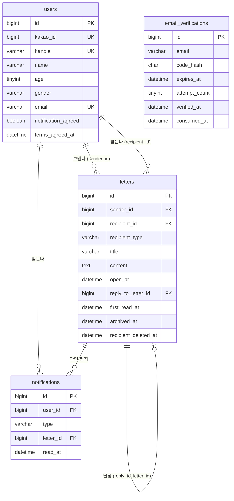

# 02. 데이터베이스 설계 (MySQL 8.0)

> 마이그레이션: `migrations/001_init.sql` · MySQL 8.0.46 에서 실행과 제약 조건 동작 확인함
> 이전 초안(PostgreSQL)에서 MySQL 로 바뀌었다. 바뀐 점은 맨 아래 "PostgreSQL 초안과 다른 점" 참고.

## ERD

## 테이블

| 테이블 | 역할 | 핵심 제약 |
|---|---|---|
| users | 카카오 회원번호로 로그인, 아이디(handle)로 받는 사람 지정 | kakao_id·handle·email UNIQUE, 아이디 형식 CHECK, 나이·성별 CHECK |
| email_verifications | 가입 전 이메일 인증 코드 (SHA-256 해시만 저장) | 5분 만료, 시도 5회, 사용(consumed) 후 재사용 불가 |
| letters | 편지 1통 = 받는 사람 1명. 받는 사람 쪽 상태(첫 열람·보관·삭제)도 같은 행 | self ⇔ 보낸 사람 = 받는 사람, 제목 1~50자, 본문 1~1000자, 공개 시각 > 작성 시각, 답장 1통(reply_to_letter_id UNIQUE) |
| notifications | 도착·봉인 해제·답장 마감·답장 도착 | (user_id, type, letter_id) UNIQUE → 중복 생성 방지 |

`recipient_type`: `self`(나) · `friend`(친구) · `anyone`(아무나 = 받는 쪽 "모르는 사람")

## 시간대

- 모든 시각은 `DATETIME(3)` 에 **UTC** 로 저장한다. 연결마다 `SET time_zone = '+00:00'`, mysql2 `timezone: 'Z'`.
- "지금"은 항상 DB 의 `UTC_TIMESTAMP(3)` 로 판단한다 (앱 서버·기기 시계 아님).
- 공개일 `'2027-10-21'`(KST) → `open_at = 2027-10-20 15:00:00 UTC` (앱에서 계산, `src/utils/time.js`).
- 한국은 서머타임이 없어 KST = UTC+9 고정 오프셋으로 계산한다 (`+ INTERVAL 9 HOUR`). MySQL 시간대 테이블이 없어도 된다.
- D-day: `DATEDIFF(DATE(open_at + 9h), DATE(now + 9h))`, 답장 가능: `open_at <= now < open_at + 1일`.

## 공개 전 내용 접근 제한

조회 SQL 자체가 `CASE WHEN open_at <= UTC_TIMESTAMP(3) THEN title END` 처럼 공개 전 제목·본문·미리보기를 NULL 로 만든다 (`src/repositories/letters.repository.js`). 서비스 코드가 실수해도 응답에 내용이 실릴 수 없다.

## 트랜잭션

| 작업 | 함께 바뀌는 것 |
|---|---|
| 회원가입 | 인증 기록 잠금(`FOR UPDATE`) → 사용자 INSERT → 인증 기록 사용 처리 |
| 이메일 코드 확인 | 최신 코드 잠금 → 시도 횟수 증가 또는 인증 완료 |
| 편지 쓰기 | 편지 INSERT + 받는 사람 "도착" 알림 |
| 공개 전 수정·삭제 | 편지 잠금 → DB 시각으로 공개 전인지 다시 확인 → 변경 |
| 답장 | 원래 편지 잠금 → 답장 가능 확인 → 답장 INSERT + "답장 도착" 알림 (동시 답장은 UNIQUE 가 최종 방어) |

## PostgreSQL 초안과 다른 점

| 항목 | PostgreSQL 초안 | MySQL | 이유 |
|---|---|---|---|
| 시각 타입 | TIMESTAMPTZ | DATETIME(3) + UTC 고정 | MySQL TIMESTAMP 는 2038년 한계가 있어 10년 뒤 공개일에 불리 |
| 이메일 대소문자 | `lower(email)` 인덱스 | 기본 정렬규칙(_ai_ci)의 UNIQUE | MySQL 기본이 대소문자 무시 |
| 답장 1통 | 부분 UNIQUE 인덱스 | 일반 UNIQUE | MySQL UNIQUE 는 NULL 을 여러 개 허용해서 같은 효과 |
| 사용자 FK 삭제 동작 | ON DELETE CASCADE | 기본(RESTRICT) | MySQL 은 CHECK 에 쓰인 컬럼(sender_id, recipient_id)에 FK 삭제 동작을 허용하지 않음. 탈퇴 기능은 아직 없음 |
| 부분 인덱스 | WHERE 조건 인덱스 | 복합 인덱스 | MySQL 은 부분 인덱스가 없음 |
| 마이그레이션 | 파일 단위 트랜잭션 | DDL 자동 커밋 | MySQL DDL 은 되돌릴 수 없음. 실패 시 로그 보고 수동 정리 |
| 이미지 | image_key 컬럼 | 이번 범위에서 제외 | 아래 "남은 작업" |
